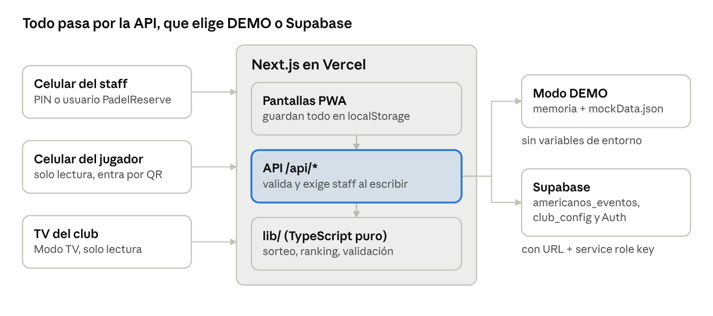

# La Marina Americanos · Manual y guía de integración

Versión compartible (con comentarios): https://claude.ai/artifact/DLqeP7UWsT6SBd3hoB2Xs7

## Resumen

La Marina Americanos es una app web instalable (PWA) para organizar americanos y torneos de pádel en La Marina Sport Club. Reemplaza la app de americanos de pago que usa hoy el club y forma parte del sistema PadelReserve.

Ya funciona sola en modo DEMO, sin base de datos. Para producción, Juan solo tiene que conectar Supabase y definir unas variables de entorno (sección "Pasos para Juan").

| Qué | Dónde |
| --- | --- |
| Código | [github.com/Lfzv98/lamarinasportclub](https://github.com/Lfzv98/lamarinasportclub) (rama `main`) |
| Dirección prevista | lamarinasportclub.vercel.app |
| Doc técnica en el repo | `docs/BACKEND.md`, `README.md`, `supabase/schema.sql` |
| Tipos de datos | `types/americano.ts` |

El club tiene 4 pistas techadas (1 a 4) y 1 sin techo (5); la app ya viene configurada así. Los horarios del club, el Instagram y la dirección son provisionales hasta que el club confirme los datos reales.

## Funcionalidades

| Área | Qué hace |
| --- | --- |
| Categorías | Femenino, Masculino y Mixto, cada una en 7ma, 6ta, 5ta, 4ta, 3ra y Open (Open Mixto en Mixto) |
| Formatos | **Individual**: cambias de pareja cada ronda. **Dupla fija**: parejas inscritas, todos contra todos. **Mixto**: como Individual, pero cada pareja es siempre un hombre y una mujer |
| Puntuación | 100% personalizable: puntos (24 en total, a 13 o cualquier número), games (5 en total, a 6, etc.) con tie-break opcional si empatan, o sets (1, mejor de 3 o de 5, a 4 o 6 games) con super tie opcional. Punto de oro o ventaja |
| Criterio del ranking | Todos los puntos (cada jugador suma los puntos de su pareja, gane o pierda), Solo rondas ganadas, o Por victorias (3 por ganar, 1 por empate) |
| Sorteo de parejas | Algoritmo balanceado: no repite compañero, reparte rivales y equilibra niveles. Quien descansa se elige por justicia (el que menos jugó) |
| Pistas y horario | De 1 a 6 pistas. Calcula cuántas rondas caben en el horario del evento. Botón "¿Llueve?" que deja solo las pistas techadas |
| En vivo | Cronómetro por ronda (iniciar, pausar, reiniciar), modal táctil para cargar marcadores, deshacer, avance de ronda |
| Ranking | Tabla animada en tiempo real con PJ, PG, PP, PF, PC y +/-, flechas de subida y bajada, podio al final |
| Modo TV | Pantalla completa para el televisor del club: pistas en juego, ranking que rota cada 12 s y un QR con la marca PR de PadelReserve para que los jugadores vean la tabla en su celular |
| QR grande | Botón QR en la barra del evento (y tocando el QR en Modo TV): lo abre a pantalla completa para escanearlo fácil |
| Cambios de plantel | Retirar a un jugador o pareja (lesión), sumar a quien llegó tarde o reincorporar. Lo jugado se conserva y se re-sortean solo las rondas que faltan |
| Mi club | Pistas (techada o no), horario por día de la semana, minutos entre rondas y contacto |
| Permisos | Solo el staff edita (PIN del club o usuario de PadelReserve). Los jugadores ven todo en modo espectador |
| Sin señal | Todo se guarda en el dispositivo. Los cambios pendientes se suben solos al volver la conexión |
| Varios dispositivos | Dos celulares pueden cargar pistas distintas a la vez sin pisarse |
| Instalable | Se instala como app en iPhone, Android y computador, con el logotipo oficial de La Marina como ícono, el isotipo "S." como favicon y página sin conexión |
| Pantallas | Probada en celular, tablet, computador, TV 720p, 1080p, 4K y TV vertical |

## Manual de uso

Hay dos tipos de usuario: el **staff**, que crea eventos y carga marcadores, y los **jugadores**, que solo miran.

### Ingresar como staff

1. Toca **Soy staff** (aparece en cualquier pantalla que lo pida).
2. Escribe el PIN del club en el teclado. Con 4 dígitos entra solo, sin botón.
3. Si Supabase está conectado, también puedes ingresar con tu usuario de PadelReserve (pestaña "PadelReserve").
4. La sesión dura 12 horas en ese dispositivo. Para salir, toca el chip de staff y confirma.

Tras 5 PIN incorrectos seguidos, ese dispositivo espera 10 minutos.

### Crear un americano (staff)

En el inicio, toca **Nuevo Americano**. El asistente tiene 5 pasos y guarda el borrador si se cierra la app.

1. **Categoría:** Femenino, Masculino o Mixto, y el nivel (7ma a Open).
2. **Formato:** Individual, Dupla fija o Mixto; las reglas del partido (ver "Reglas de puntuación") y el criterio del ranking.
3. **Pistas:** cuáles se usan, fecha, hora de inicio y fin, y minutos por ronda. La app muestra cuántas rondas caben. Si llueve, el botón **¿Llueve?** deja solo las pistas techadas.
4. **Jugadores:** nombres (y género en Mixto), o parejas en Dupla fija. Avisa si falta gente o sobra para las pistas.
5. **Listo:** revisa el resumen y crea el evento. Las rondas se sortean solas.

### Reglas de puntuación

En el paso Formato se elige cómo se cuenta y se escribe cualquier número. Los atajos cubren lo habitual y el contador permite el resto. Abajo siempre aparece el resumen, por ejemplo "5 games en total · si quedan 2-2, tie a 5 · punto de oro".

| Método | Opciones | Ejemplo |
| --- | --- | --- |
| Puntos | En total o primero en llegar; de 4 a 99 puntos | "24 en total" (13-11) o "a 13" (13-9) |
| Games | En total o primero en llegar; de 1 a 15 games; punto de oro o ventaja; tie-break opcional de 3 a 21 puntos | 5 games en total: si quedan 2-2, el último game es un tie a 5 (3-2, tie 5-3) |
| Sets | 1 set, mejor de 3 o de 5; de 2 a 9 games por set; punto de oro o ventaja; super tie opcional en el set decisivo | Mejor de 3 a 6 games, 3er set super tie a 10 (6-4, 5-7, 10-8) |

Al cargar el marcador, la app solo acepta resultados posibles con esas reglas y ofrece atajos con los finales válidos. Si el partido se definió en el tie-break, se puede anotar su marcador (es opcional y se muestra en la tarjeta de la pista). Si se acaba el tiempo antes de terminar, se puede guardar el marcador parcial.

### Durante el evento (staff)

- Pestaña **Cuadro**: ves la ronda actual con cada pista. Toca **Iniciar ronda** para arrancar el cronómetro; puedes pausar y reanudar.
- Toca una pista para **cargar marcador**. El modal no deja guardar un resultado imposible para el método elegido. Cada carga tiene **Deshacer**.
- Con todas las pistas cargadas, toca **Siguiente** (o **Finalizar** en la última ronda). Se puede volver a una ronda anterior para corregir.
- Botón **Jugadores** (o Parejas): retirar a alguien, sumar a quien llegó tarde o reincorporar. Solo se re-sortean las rondas que faltan.
- **Eliminar evento** pide confirmar y escribir ELIMINAR.

### Ranking y Modo TV

- Pestaña **Ranking**: tabla en vivo con PJ (jugados), PG (ganados), PP (perdidos), PF (puntos a favor), PC (en contra) y +/-. Abajo explica cómo se calcula. Al final muestra el podio y un botón para compartir.
- Pestaña **Modo TV**: ábrela en el computador o Smart TV del club y ponla en pantalla completa. La pantalla no se apaga, el cursor se esconde y el ranking cambia de página cada 12 s. El QR lleva a la tabla en el celular; tocándolo se ve a pantalla completa.

### Jugadores (sin cuenta)

Escanean el QR del Modo TV, el QR grande que muestra el staff (botón QR en la barra de abajo) o abren el enlace compartido. Ven cuadro, ranking y su pista en "modo espectador", sin poder cambiar nada.

### Mi club (staff)

En el inicio, **Mi club** permite editar las pistas (nombre y si es techada), el horario de apertura y cierre por día, los minutos entre rondas y el contacto. Los eventos nuevos usan estos datos.

### Instalar la app

- **Android / Chrome:** botón **Instalar** en la app, o menú ⋮ → Instalar app.
- **iPhone:** en Safari, Compartir → Agregar a inicio.

## Tecnología y arquitectura

Es una sola app Next.js: las pantallas y la API viven en el mismo proyecto y se publican juntas en Vercel. Toda la lógica de juego es TypeScript puro en `lib/`, sin dependencias, así se puede reutilizar en el backend de PadelReserve.



Los tres tipos de pantalla hablan con la misma app. La API decide sola dónde guardar: memoria en DEMO, o Supabase cuando están sus variables.

### Stack

| Pieza | Versión | Para qué |
| --- | --- | --- |
| Next.js (App Router) | 15.5 | Pantallas y API (`app/api`) |
| React | 19 | Interfaz |
| TypeScript | 5.9 | Tipos en todo el proyecto |
| Tailwind CSS | 4 | Estilos, glassmorphism, tema oscuro |
| Framer Motion | 12 | Animaciones (ranking, modales, confetti) |
| lucide-react | 1.6 | Íconos |
| zustand | 5 | Estado del cliente guardado en el dispositivo |
| qrcode | 1.5 | QR del Modo TV |
| Node.js | 22 o más | Build y tests |

Color de marca: verde #7FE302 del logo de La Marina. Tipografías Inter y Space Grotesk.

### Carpetas

| Ruta | Contenido |
| --- | --- |
| `app/` | Pantallas: inicio, `setup`, `club`, `evento/[id]` (cuadro), `evento/[id]/tabla`, `evento/[id]/tv`, `offline` |
| `app/api/` | `americanos`, `americanos/[id]`, `club`, `staff/login`, `staff/logout`, `staff/me` |
| `types/americano.ts` | Jugador, Pareja, Partido, Ronda, TablaPosiciones, EventoAmericano, ConfigClub |
| `lib/rotation.ts` | Sorteo de parejas y rondas |
| `lib/scoring.ts` | Validación de marcadores y cálculo del ranking |
| `lib/evento.ts` | Ciclo de vida del evento, cronómetro, cambios de plantel, fusión |
| `lib/horarios.ts` | Horarios del club, pistas, rondas que caben |
| `lib/validacion.ts` | Validación estricta de lo que llega a la API |
| `lib/store.ts` | Estado local y sincronización |
| `lib/server/` | Repositorio (DEMO o Supabase), auth de staff, manejo de errores HTTP |
| `public/` | Manifest PWA, service worker `sw.js`, logo e íconos |
| `supabase/schema.sql` | Tablas mínimas |
| `tests/` | Tests de lógica y de navegador |

### Cómo funciona el sorteo

- **Individual y Mixto:** búsqueda local con reinicios y semilla fija (el mismo evento siempre da el mismo cuadro). Penaliza repetir compañero (mucho), repetir rival (algo) y el desequilibrio de nivel entre parejas. En Mixto cada pareja es un hombre y una mujer.
- **Descansos:** si sobran jugadores para las pistas, descansa quien menos jugó.
- **Dupla fija:** todos contra todos por el método del círculo, repartido en rondas según las pistas.
- **Re-sorteo:** al cambiar el plantel, las rondas ya jugadas cuentan como historial y solo se regeneran las siguientes, con ids nuevos.

### Sincronización

- Cada dispositivo guarda los eventos en su `localStorage`. La app funciona sin internet.
- Las pestañas del mismo navegador se actualizan al instante (BroadcastChannel). Otros dispositivos consultan `GET /api/americanos` cada 8 s.
- Los cambios sin confirmar quedan en una cola y se suben solos al volver la conexión.
- El servidor nunca sobrescribe a ciegas: fusiona la versión guardada con la entrante. Cada marcador conserva su carga más reciente, así dos celulares no se pisan.
- Las marcas de tiempo siempre avanzan, aunque el reloj del celular esté atrasado. Borrar un evento es lógico, para que una copia vieja no lo reviva.

### Seguridad

- Leer es público. Toda escritura exige sesión de staff y responde `401` sin ella.
- La sesión es una cookie `lm_staff` httpOnly firmada con HMAC (`STAFF_SECRET`), válida 12 h.
- 5 intentos fallidos por IP cada 10 minutos; después responde `429`.
- La service role key de Supabase solo se usa en el servidor, nunca llega al navegador.
- `npm audit` sin vulnerabilidades.

## Pasos para Juan: integración con PadelReserve

La integración mínima son 5 pasos y no toca las tablas existentes de PadelReserve. El frontend solo habla con la API, así que el único archivo que hay que cambiar para un mapeo más profundo es `lib/server/repository.ts`.

### 1. Correr en local

```bash
git clone https://github.com/Lfzv98/lamarinasportclub.git
cd lamarinasportclub
npm install
cp .env.example .env.local   # vacío = modo DEMO
npm run dev                  # http://localhost:3000, PIN 1234
npm test                     # 37 tests de lógica
```

### 2. Crear las tablas en Supabase

En el SQL Editor del proyecto de PadelReserve, corre `supabase/schema.sql`. Crea dos tablas con RLS activado:

| Tabla | Columnas | Contenido |
| --- | --- | --- |
| `americanos_eventos` | `id` text PK, `data` jsonb, `estado` text, `actualizado_en` timestamptz | Un `EventoAmericano` completo por fila |
| `club_config` | `id` text PK (`la-marina`), `data` jsonb | `ConfigClub`: pistas, horarios, contacto |

### 3. Variables de entorno en Vercel

En Vercel → Settings → Environment Variables, y luego un Redeploy:

| Variable | Obligatoria | Valor |
| --- | --- | --- |
| `NEXT_PUBLIC_SUPABASE_URL` | Sí | URL del proyecto Supabase |
| `SUPABASE_SERVICE_ROLE_KEY` | Sí | Service role key (solo servidor) |
| `STAFF_SECRET` | Sí | Cadena aleatoria de 16 caracteres o más |
| `STAFF_PIN` | Recomendada | PIN del staff, 4 a 8 dígitos. Con Supabase, si falta, el PIN se desactiva |
| `NEXT_PUBLIC_SUPABASE_ANON_KEY` | Para login PadelReserve | Anon key (si falta, usa la service role) |
| `STAFF_EMAILS` | Opcional | Correos con permiso de staff, separados por coma |
| `SUPABASE_AMERICANOS_TABLE` / `SUPABASE_CLUB_TABLE` | Opcional | Si quieres otros nombres de tabla |

Con las dos primeras, la app cambia sola de DEMO a SUPABASE y el badge pasa de "Demo" a "En línea".

### 4. Dar acceso de staff a usuarios de PadelReserve

El login con correo y contraseña se valida contra Supabase Auth. Entra quien tenga `app_metadata.role` igual a `staff` o `admin`, o quien esté en `STAFF_EMAILS`.

```sql
update auth.users
set raw_app_meta_data = raw_app_meta_data || '{"role":"staff"}'
where email = 'correo-del-staff@ejemplo.com';
```

### 5. Verificar

- [ ] `GET /api/americanos` responde `"modo": "SUPABASE"`.
- [ ] Ingresar como staff, crear un evento y verlo en la tabla `americanos_eventos`.
- [ ] Abrir el evento en otro celular sin sesión: se ve en modo espectador y no deja editar.
- [ ] Correr las pruebas de navegador contra el deploy: `APP_URL=https://lamarinasportclub.vercel.app STAFF_PIN=<pin> node tests/e2e/robustez.e2e.mjs` (usa una base de pruebas).

### Integración más profunda (opcional)

Para usar las tablas normalizadas de PadelReserve (jugadores = usuarios, reservas de pista), implementa esta interfaz en `lib/server/repository.ts`:

```ts
interface AmericanosRepository {
  listar(): Promise<EventoAmericano[]>;
  obtener(id: string): Promise<EventoAmericano | null>;
  guardar(evento: EventoAmericano): Promise<EventoAmericano>; // upsert por id
  eliminar(id: string): Promise<boolean>;
  obtenerClub(): Promise<ConfigClub>;
  guardarClub(club: ConfigClub): Promise<ConfigClub>;
}
```

Puntos de enganche ya previstos en los tipos:

- `Jugador.usuarioId` y `Jugador.fotoUrl`: el usuario de PadelReserve y su foto.
- `EventoAmericano.reservaIds`: las reservas que bloquean las pistas del evento.
- `EventoAmericano.canchas`: las pistas físicas usadas (número, nombre, techada).
- Tiempo real: el polling de 8 s está en `components/Providers.tsx` y se puede cambiar por una suscripción Supabase Realtime a `americanos_eventos`.

Si escribe en la base desde otro sistema, debe usar `fusionarEventos` de `lib/evento.ts` antes de guardar, para no pisar marcadores. Los detalles están en `docs/BACKEND.md`.

### API

| Método | Ruta | Quién | Cuerpo / respuesta |
| --- | --- | --- | --- |
| GET | `/api/americanos` | Público | `{ modo, eventos }` (`?todos=1` incluye eliminados) |
| POST | `/api/americanos` | Staff | `{ evento }` → upsert con fusión, `201` o `200` |
| GET | `/api/americanos/:id` | Público | `{ modo, evento, tabla }`, `404` si no existe |
| PUT | `/api/americanos/:id` | Staff | `{ evento }`, el id debe coincidir |
| DELETE | `/api/americanos/:id` | Staff | Borrado lógico, `204` |
| GET | `/api/club` | Público | `{ modo, club }` |
| POST | `/api/club` | Staff | `{ club }` |
| POST | `/api/staff/login` | Público | `{ pin }` o `{ email, password }` → cookie |
| GET | `/api/staff/me` | Público | `{ staff, metodos }` |
| POST | `/api/staff/logout` | Público | Borra la cookie |

Errores, siempre en JSON: `400` JSON mal formado, `401` sin sesión, `403` usuario sin rol staff, `404` no existe, `413` cuerpo mayor a 1 MB, `422` validación fallida (con `detalles` en español), `429` demasiados intentos, `502` Supabase falló, `500` error inesperado.

## Pruebas y solución de problemas

Antes de entregar pasaron 37 tests de lógica (`npm test`), 22 pruebas en navegador real con Playwright, `tsc --noEmit` sin errores y el build de Next.js.

| Prueba | Qué cubre |
| --- | --- |
| Rotación | Sin compañeros repetidos, descansos justos, Mixto siempre hombre + mujer, Dupla fija todos contra todos |
| Puntuación | Marcadores imposibles rechazados, puntos a 13, games en total con tie a 2-2, super tie, los 3 criterios de ranking, desempates |
| Robustez | Dos dispositivos a la vez, reloj del celular atrasado, sin internet, datos locales corruptos, re-sorteos, borrado |
| API | `401` sin sesión, PIN incorrecto, `429` al sexto intento, cookie falsa, `400`, `413`, `422`, `404` |
| Pantallas | Celular, tablet, computador, TV 720p, 1080p, 4K y vertical |
| Espectador | Un jugador sin sesión no puede editar nada |

### Preguntas frecuentes

| Problema | Solución |
| --- | --- |
| El badge dice "Demo" en producción | Faltan `NEXT_PUBLIC_SUPABASE_URL` o `SUPABASE_SERVICE_ROLE_KEY`, o falta el Redeploy después de agregarlas |
| "N por subir" en el badge | Hay cambios guardados en el celular esperando conexión o sesión. Se suben solos; si persiste, ingresar de nuevo como staff |
| El PIN no funciona con Supabase | Con Supabase el PIN solo existe si `STAFF_PIN` está definido |
| "Demasiados intentos" | Esperar 10 minutos o ingresar desde otra red |
| Un usuario de PadelReserve recibe 403 | No tiene rol `staff` o `admin` ni está en `STAFF_EMAILS` (paso 4) |
| Se fue la luz o la señal | Seguir cargando: todo queda en el celular y se sube al volver |
| Llegó un jugador tarde o se lesionó uno | Botón Jugadores en el cuadro; se re-sortea desde la próxima ronda |
| La TV se ve cortada | Usar pantalla completa (F11 o el botón del Modo TV); el lienzo se adapta a cualquier resolución |
| Las sesiones se cierran todas | Cambió `STAFF_SECRET`; es normal, hay que volver a ingresar |

### Pendiente

- [ ] Datos reales del club: horario de apertura por día, nombres de las pistas, dirección e Instagram (hoy son provisionales y se editan en Mi club).
- [ ] Elegir el `STAFF_PIN` definitivo y un `STAFF_SECRET` largo en Vercel.
